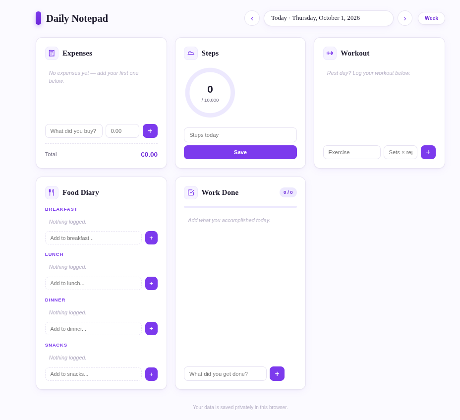

# Daily Notepad

A simple, private daily tracking app — no account, no server, no tracking. Your data stays in your browser's localStorage.



## Features

| Section | What it tracks |
|---|---|
| **Expenses** | Log purchases with name and amount; running total at the bottom |
| **Steps** | Daily step count with a progress ring toward a 10,000-step goal |
| **Workout** | Exercises with sets × reps detail |
| **Food Diary** | Meals organised by Breakfast, Lunch, Dinner, and Snacks |
| **Work Done** | Task checklist with a progress bar and done/total badge |

A **Week** button in the header opens a summary modal with stats and bar charts for the last 7 days.

All data is stored per-day in your browser. Use the **‹ ›** arrows to navigate between dates.

## Running Locally

No build step or dependencies needed — it's plain HTML/CSS/JS.

```bash
# Option 1: just open the file
open index.html        # macOS
xdg-open index.html    # Linux

# Option 2: serve it (recommended)
python3 -m http.server 8000
# then visit http://localhost:8000
```

## Adding Your Own Section

The app is designed to be easy to extend. Here's how to add a new card (e.g. a "Water Intake" tracker):

### 1. Add the HTML card

Open `index.html` and add a new `<section>` inside the `<main class="grid">` block, after the existing cards:

```html
<!-- Water Intake -->
<section class="card" id="card-water">
  <div class="card-head">
    <span class="card-icon">
      <svg viewBox="0 0 24 24" fill="none" stroke="currentColor" stroke-width="2" stroke-linecap="round" stroke-linejoin="round"><path d="M12 2.7l5.66 5.66a8 8 0 1 1-11.31 0z"/></svg>
    </span>
    <h2>Water Intake</h2>
  </div>
  <ul class="item-list" id="waterList"></ul>
  <form class="add-form" id="waterForm">
    <input type="text" id="waterAmount" placeholder="Glasses" autocomplete="off" />
    <button type="submit" class="add-btn" aria-label="Add water">+</button>
  </form>
</section>
```

### 2. Add the data field

In `app.js`, add your new field to the `emptyDay()` function:

```js
function emptyDay() {
  return {
    expenses: [],
    steps: 0,
    workout: [],
    food: { Breakfast: [], Lunch: [], Dinner: [], Snacks: [] },
    work: [],
    water: [],          // ← add this line
  };
}
```

### 3. Add a render function

In `app.js`, add a render function for your section (place it near the other render functions):

```js
function renderWater(data) {
  const list = document.getElementById("waterList");
  list.innerHTML = "";

  if (data.water.length === 0) {
    list.innerHTML = `<li class="empty">No water logged yet.</li>`;
  } else {
    data.water.forEach((w) => {
      const li = document.createElement("li");
      li.className = "item";
      li.innerHTML = `
        <span class="item-text">${escapeHtml(w.amount)}</span>
        <button class="del" aria-label="Delete">&times;</button>`;
      li.querySelector(".del").addEventListener("click", () => {
        data.water = data.water.filter((x) => x.id !== w.id);
        save();
        render();
      });
      list.appendChild(li);
    });
  }
}
```

### 4. Wire it into the render loop

In the `render()` function, add a call to your new render function:

```js
function render() {
  // ... existing code ...
  renderExpenses(data);
  renderSteps(data);
  renderWorkout(data);
  renderFood(data);
  renderWork(data);
  renderWater(data);    // ← add this line
}
```

### 5. Add the form event listener

At the bottom of `app.js` (near the other form listeners), add:

```js
document.getElementById("waterForm").addEventListener("submit", (e) => {
  e.preventDefault();
  const amount = document.getElementById("waterAmount").value.trim();
  if (!amount) return;
  data.water.push({ id: uid(), amount });
  save();
  e.target.reset();
  render();
});
```

That's it — your new section will appear as a card, persist per-day, and survive page reloads.

## Project Structure

```
daily-notepad/
├── index.html      # Markup — all card sections live here
├── styles.css      # Styling — card grid, animations, modal
├── app.js          # Logic — state, rendering, localStorage, events
├── screenshot.png  # App screenshot (this file)
└── README.md       # This file
```

## Tech Stack

- **HTML5** — semantic markup
- **CSS3** — custom properties, grid, flexbox, animations
- **Vanilla JavaScript** — no frameworks, no build tools
- **localStorage** — per-day JSON persistence
